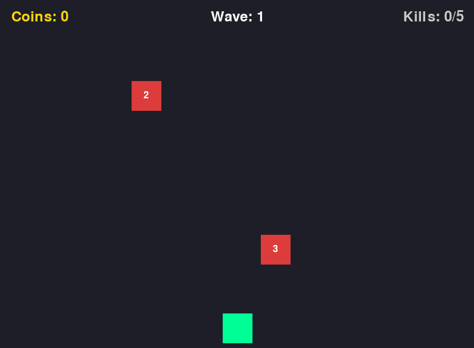

# Systems-Driven Upgrade Game

A small 2D arcade-style game built with **Python** and **Pygame**. The player moves horizontally, shoots incoming enemies, earns coins, and purchases upgrades between waves.

The project focuses on game-state management, object-oriented design, collision detection, progression systems, and a simple upgrade economy.

## Gameplay Demo



## Features

- Real-time player movement and shooting
- Enemy spawning with health and fall speed that scale by wave
- Projectile/enemy collision detection
- Coin rewards based on defeated enemy health
- Wave progression system
- Separate wave-cleared and wave-lost states
- Upgrade shop between waves
- Damage upgrades
- Player movement-speed upgrades
- Fire-rate upgrades with dynamic pricing
- Retry system after losing a wave
- Modular object-oriented structure using separate classes for the player, enemies, bullets, and game controller

## Project Structure

```text
.
├── assets/
│   └── demo.gif
├── main.py
├── game.py
├── player.py
├── enemy.py
├── bullet.py
├── settings.py
├── requirements.txt
├── README.md
└── .gitignore
```

### File Overview

- `main.py` — Entry point for the game
- `game.py` — Main game loop, state management, collisions, progression, shop logic, and rendering
- `player.py` — Player movement, shooting, and upgradeable stats
- `enemy.py` — Enemy movement, health, scaling, and rendering
- `bullet.py` — Projectile movement and rendering
- `settings.py` — Shared constants such as screen dimensions, colors, and gameplay values
- `requirements.txt` — Python package requirements
- `assets/demo.gif` — Short gameplay demonstration used in this README

## Requirements

- Python 3
- Pygame 2.5 or newer

Install the required package with:

```bash
pip install -r requirements.txt
```

## Running the Game

Clone the repository or download the project files, open a terminal in the project directory, and run:

```bash
python main.py
```

Depending on your system, you may need to use:

```bash
python3 main.py
```

## Controls

| Control | Action |
| --- | --- |
| `A` / Left Arrow | Move left |
| `D` / Right Arrow | Move right |
| `Space` | Shoot |
| Left Mouse Button | Select shop upgrades and menu buttons |

## Gameplay

Enemies fall from the top of the screen. Shoot them before they reach the bottom.

Defeating enemies awards coins based on their maximum health. After defeating the required number of enemies, the wave is cleared and the upgrade shop becomes available.

If an enemy reaches the bottom of the screen, the wave is lost. You can use your available coins to purchase upgrades and retry the same wave.

As waves increase, enemies can have more health, move faster, and spawn more frequently.

## Upgrade System

The shop currently includes three upgrade paths:

- **Damage** — Increases damage dealt by each projectile
- **Player Speed** — Increases horizontal movement speed
- **Fire Rate** — Reduces the delay between shots

Upgrade costs increase as each stat is leveled.

## Technical Concepts Used

This project demonstrates:

- Object-oriented programming
- Game loops
- State machines
- Collision detection
- Timed spawning and cooldowns
- Dynamic difficulty scaling
- Resource/economy systems
- Modular Python project organization
- Pygame rendering and input handling

## Future Improvements

Possible additions include:

- Sprites and animations
- Sound effects and music
- Additional enemy types
- Boss waves
- More upgrade paths
- Player health or lives
- High-score tracking
- Start/pause menus
- Saved progression
